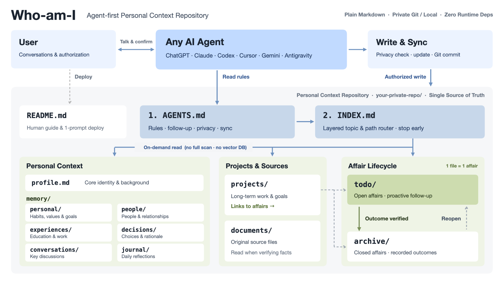

# Who-am-I

[简体中文](README.md) | **English**

**Agent-first Personal Context Repository**



Who-am-I is a portable framework for keeping personal background, experiences, relationships, decisions, conversations, projects and affairs in a repository you control. Different AI agents can retrieve relevant context on demand and maintain records with authorization.

- **Agent-first:** designed for agents to retrieve, understand and maintain context.
- **Portable:** works with ordinary files, relative links and Git or local storage.
- **Zero runtime dependencies:** no database, embeddings, MCP server or background service required.
- **Single source of truth:** maintain one authoritative record and link to it.
- **On-demand retrieval:** stop reading once sufficient context has been obtained.
- **User control:** access, writing, privacy and history remain under the owner's control.

## One-prompt deployment

Send this prompt to an AI agent with GitHub or file-management capabilities:

```text
Read the README at https://github.com/EricFeng9/Who-am-I-Public and follow its deployment procedure to create and configure my own private personal context repository. Execute authorized steps automatically where possible, guide me through any required manual actions or permissions, and provide the persistent instructions for using the repository with any AI agent.
```

## Deployment procedure

1. Read this README, [AGENTS.md](AGENTS.md) and [INDEX.md](INDEX.md). Obtain the blank public framework only.
2. Confirm the destination account, repository name and local path as applicable. Prefer an independent private repository named `Who-am-I`, or controlled local storage. Inspect existing files before reusing a repository.
3. Copy the blank framework into the independent private repository. Use GitHub's template feature if available, or download/clone the public files and commit them to a new private repository. Guide the user through any steps the agent cannot perform.
4. Verify the destination account, remote, permissions and visibility before storing personal data. Public forks remain public; use them only for framework contributions. Never request passwords or access tokens in chat. Pause personal writes until private storage is verified.
5. With authorization, initialize language, time zone, basic background and memory preferences in `profile.md` and relevant records. Allow the user to skip questions. Import private sources only with explicit authorization.
6. Configure the actual repository address or local path in the persistent instructions below. Assist with platform-specific permissions and configuration.
7. Verify the entry points, relative links, repository visibility and read access. Test writes only with authorization, using confirmed initialization records. Report the repository address, persistent instructions, completed operations and remaining manual steps.

For manual setup, create a separate private repository, copy the framework files while retaining their structure, verify the remote and push. Alternatively use a local-only copy. A public fork is suitable for contributing generic framework changes.

## Cross-platform persistent instructions

Copy the following into your AI platform's custom instructions or personal rules. Use the actual repository address or local path and grant the necessary access.

```text
My personal context, long-term memory and personal affairs are stored in YOUR_GITHUB_OWNER/YOUR_PRIVATE_REPOSITORY, which may also have a local copy.

For requests involving my circumstances, experiences, projects, plans, relationships, decisions or other personal affairs, read the repository's AGENTS.md and retrieve relevant context on demand through INDEX.md.

Proactively identify information worth retaining, update and organize the repository within my authorization, and follow up unfinished affairs in todo/ at appropriate times. Ground personal context in sourced records and my latest confirmations, follow privacy rules and verify saved changes.

General questions do not require access to personal records. If access is unavailable, explain the limitation. Do not guess personal facts or claim that unsaved information has been recorded.
```

| Environment | Setup |
| --- | --- |
| ChatGPT or other AI with GitHub access | Connect GitHub, authorize the private repository and configure the instructions |
| Codex, Claude Code, Cursor, Gemini CLI, Antigravity | Provide the local repository path and configure the supported personal rules or session instructions |
| Attachment-only AI | Provide AGENTS.md, INDEX.md and relevant records; save changes through an authorized agent or manually |

Instructions alone do not grant access. Actual retrieval, automatic loading and writing depend on each platform's capabilities and permissions.

## Architecture and repository layout

| Path | Purpose |
| --- | --- |
| [README.md](README.md) / [README.en.md](README.en.md) | Human-facing documentation and setup |
| [AGENTS.md](AGENTS.md) | Agent operating rules, privacy and synchronization |
| [INDEX.md](INDEX.md) | Global navigation |
| [profile.md](profile.md) | Core identity and background |
| [memory/personal/](memory/personal/INDEX.md) | Habits, values, goals and preferences |
| [memory/people/](memory/people/INDEX.md) | People and relationships |
| [memory/experiences/](memory/experiences/INDEX.md) | Education, research, work and life experiences |
| [memory/decisions/](memory/decisions/INDEX.md) | Decisions and rationale |
| [memory/conversations/](memory/conversations/INDEX.md) | Significant conversations |
| [memory/journal/](memory/journal/INDEX.md) | Daily experiences and reflections |
| [projects/](projects/INDEX.md) | Long-term projects and related affairs |
| [todo/](todo/INDEX.md) | All unfinished affairs |
| [archive/](archive/INDEX.md) | Closed or explicitly terminated affairs |
| [documents/](documents/INDEX.md) | Original source materials |

Each fact, decision or affair has a single authoritative record. Indexes contain navigation, and related records link to that source. As the repository grows, organize records by topic or date and read only what the current request requires.

## Affair lifecycle and proactive follow-up

Maintain one Markdown file per affair. Keep it in `todo/` while work or an outcome remains pending. For example, submitting a competition entry completes an action, but the affair remains open until its result is known. When discussing a related topic or reviewing upcoming tasks, the agent checks relevant open affairs and follows up at an appropriate time. Prefer authorized reliable sources, then ask the owner if necessary.

Record expected result dates and recent checks when useful, to avoid repeated questions. Once the final outcome or explicit termination is verified and recorded, move the same file to `archive/` and update its references. Reopen an affair by moving it back to `todo/`. Recurring commitments also stay in `todo/` while active.

The repository requires no background process. Scheduled notifications depend on the capabilities and permissions of the AI platform.

## Everyday use

Ask your agent to review upcoming tasks, advise on a career decision using your background, record a project outcome, or recall the rationale for a past decision. The agent reads the rules and indexes, retrieves relevant records, and updates authoritative files within your authorization.

## Privacy and data control

Keep personal records in a private repository or controlled local storage. Follow [AGENTS.md](AGENTS.md) for additional confirmation before saving sensitive information, including credentials, identity documents, financial details and precise residential addresses. Limit access and retain secure backups. Git history, other copies and connected services may retain information removed from current files. Keep public contributions free of personal records, attachments and private Git history. Store temporary local artifacts in the ignored `.local/` directory.

## Framework updates and migration

Ask the agent to read the latest public README and AGENTS.md, compare the generic structure and rules, and migrate applicable improvements without overwriting personal records, permissions, time zone or custom rules. Consolidate older task, completion, verification and event records into individual affairs; keep unresolved ones in todo/ and archive verified outcomes. Place daily journals in memory/journal/. Verify source files and links before removing superseded entries. Use the same repository or synchronized local copies across platforms.
