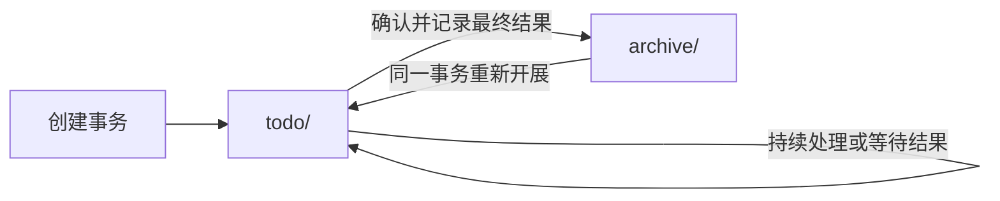

# Who-am-I

**Agent-first Personal Context Repository** · 面向 AI Agent 的个人上下文仓库

将个人背景、经历、关系、事件、决策、对话、项目和任务保存在自己控制的 Markdown 文件中，让不同 AI Agent 按需读取相关上下文，提供有针对性的帮助，并在授权范围内持续维护记忆。

- **Agent-first**：Agent 自主理解、检索、更新和整理个人上下文。
- **按需获取**：通过分层索引定位当前话题需要的记录，减少无关上下文。
- **可迁移**：支持本地文件和 Git 仓库，使用相同的资料组织与操作规范。
- **零运行依赖**：核心功能无需数据库、Embedding、MCP Server、后台服务或专用程序。
- **个人控制**：用户管理信息来源、写入授权、隐私、历史记录及访问权限。

## 一句话部署

把下面这句话直接发送给具备文件或 GitHub 操作能力的 AI Agent（例如 Codex、Claude Code、Cursor、Gemini CLI、Antigravity 或 ChatGPT）：

```text
请阅读 https://github.com/EricFeng9/Who-am-I-Public 的 README.md，按照其中的部署流程为我建立并配置专属的私有个人记忆仓库，能自动完成的步骤直接执行，需要我操作或授权的步骤逐项指导，部署完成后提供可用于任何 AI 的长期指令。
```

Agent 将协助完成框架复制、目标仓库初始化、权限确认、个人上下文配置和长期指令生成；具体可自动执行的操作取决于 Agent 的工具能力与用户授权。

## 部署流程

以下流程适用于使用者自行部署，也供收到上述部署请求的 Agent 执行。

1. **获取框架**：读取本 README、[AGENTS.md](AGENTS.md) 和 [INDEX.md](INDEX.md)，确认公开仓库的当前目录与规则。仅从公开框架获取文件。
2. **确定保存位置**：询问或确认用户希望使用的 GitHub 账户、仓库名称及本地目录（如需要）。默认建议建立名为 `Who-am-I` 的独立 Private 仓库；用户也可以选择仅在本地使用。复用已有个人仓库前读取其现有文件，保留用户已有资料。
3. **复制空白框架**：如果工具具备相应权限，直接创建独立私有仓库，并将本仓库的空白框架文件复制进去；若已启用 GitHub Template repository 功能，可通过 Use this template 创建 Private 仓库。也可以下载或 clone 本仓库，将框架文件提交至新建的独立私有仓库。如果 Agent 不能创建仓库或推送，指导用户在 GitHub 完成必要操作，并在授权后继续其余工作。
4. **确认隐私与权限**：公开仓库的 Fork 会继承公开可见性，不能单独改为 Private；公开 Fork 适合维护和贡献框架，个人记忆应保存在独立 Private 仓库或受用户控制的本地目录。使用 Git 时核对目标 remote、当前账户及目标仓库可见性，确认推送方向。未确认私人存储位置前，只允许复制空白框架，暂停写入任何个人资料。不得要求用户在聊天中粘贴密码或访问令牌。
5. **初始化个人上下文**：在用户授权下了解其语言、时区、基本背景和记忆维护偏好，填写 `profile.md` 和必要的个人记忆。用户可以暂时跳过任何问题。依据 [AGENTS.md](AGENTS.md) 按需整理其主动提供或明确授权导入的资料；未经授权不读取历史聊天、邮件、个人文档或其他私人来源。
6. **配置跨平台访问**：生成包含用户实际仓库地址或本地路径的长期指令，指导用户放入各平台的自定义指令或个人规则中。对支持 GitHub 或本地文件访问的 Agent，确认所需权限和目标仓库；工具允许时直接完成配置，需要用户操作时明确指出步骤。
7. **验证部署**：检查框架入口、相对链接、空白或经授权初始化的记录、写入授权与目标可见性。验证实际能够读取目标仓库的规则和索引；只有在获得写入授权时才执行写入测试，可使用用户确认的初始化记录。核对远程版本及实际保存结果，交付仓库地址、配置好的长期指令、已完成事项和仍需用户操作的步骤。

### 手动部署

- 在 GitHub 创建一个独立 Private 仓库。若本仓库提供 Use this template，可使用该入口直接创建私有副本。
- 下载本框架文件，或 clone 后将文件复制到自己的仓库。保留原有文件结构，将远程地址设置为自己的私有仓库，核对后提交并推送。
- 如果希望参与公开框架开发，可以另外 Fork 本仓库；公开 Fork 中仅保留通用框架和空白记录。
- 本地使用者可以直接下载或 clone 到自己的目录，确认本地访问权限后使用，无需连接 GitHub。
- 将下面的长期指令配置到需要使用的 AI 平台。

## 跨平台长期指令

将下列内容中的 `YOUR_GITHUB_OWNER/YOUR_PRIVATE_REPOSITORY` 替换为自己的实际私有仓库地址，也可替换为本地目录路径。请确保相应 AI 已取得访问授权。

```text
我的个人上下文、长期记忆及个人事务记录保存在 YOUR_GITHUB_OWNER/YOUR_PRIVATE_REPOSITORY 中，也可能提供该仓库的本地副本。

处理与我的个人情况、经历、项目、计划、关系、决策或其他个人事务有关的请求时，请读取仓库根目录的 AGENTS.md，并按照其中的规则从 INDEX.md 按需获取相关上下文。

根据我们的互动主动识别具有长期价值的个人信息，在我授权的范围内更新、整理并维护仓库；适时主动跟进 todo/ 内尚未取得结果的事务。以有来源依据的仓库记录和我最新确认的信息为个人上下文依据，遵守隐私规则，核验保存结果。

普通通用问题无需访问个人记录。若无法访问仓库，请说明限制；没有证据时不要猜测个人事实，也不要声称已经保存未实际写入的内容。
```

| 使用环境 | 配置方式 |
| --- | --- |
| 支持 GitHub 访问的 ChatGPT 等 AI | 连接 GitHub、授权个人私有仓库，在长期指令中粘贴配置文字 |
| Codex、Claude Code、Cursor、Gemini CLI、Antigravity 等本地 Agent | 提供本地仓库路径，使用工具支持的个人规则或会话指令引导其读取 AGENTS.md |
| 仅能读取附件的 AI | 提供 AGENTS.md、INDEX.md 及本次相关资料；由用户或有权限的 Agent 保存修改 |

实际自动加载、仓库创建、Fork、写入及配置能力取决于产品功能、账户权限和授权设置。长期指令不会自动授予访问权限。框架使用说明集中在本 README，Agent 操作规范集中在 AGENTS.md。

## 目录与职责

| 文件或目录 | 内容 |
| --- | --- |
| [README.md](README.md) | 使用说明、部署和跨平台配置 |
| [AGENTS.md](AGENTS.md) | Agent 检索、维护、主动跟进及隐私规则 |
| [INDEX.md](INDEX.md) | 全局导航 |
| [profile.md](profile.md) | 核心个人背景 |
| [memory/personal/](memory/personal/INDEX.md) | 习惯、目标、价值观、沟通要求 |
| [memory/people/](memory/people/INDEX.md) | 人物与关系 |
| [memory/experiences/](memory/experiences/INDEX.md) | 教育、研究、工作与生活经历 |
| [memory/decisions/](memory/decisions/INDEX.md) | 重大决定及依据 |
| [memory/conversations/](memory/conversations/INDEX.md) | 重要对话与讨论 |
| [memory/journal/](memory/journal/INDEX.md) | 日常经历、想法、感受 |
| [projects/](projects/INDEX.md) | 长期项目及关联事务 |
| [todo/](todo/INDEX.md) | 所有未完结事务 |
| [archive/](archive/INDEX.md) | 已完结或明确终止的事务 |
| [documents/](documents/INDEX.md) | 原始资料 |

## 事务如何管理

每件事务从开始到取得结果只维护一份 Markdown 记录。目录位置表达是否完结，索引只提供导航。项目文件通过链接关联事务。



例如提交比赛材料后仍需等待成绩，比赛记录继续保存在 todo/。聊到比赛或询问近期待办时，Agent 会在合适的时机主动核实结果，更新原记录；取得结果后将文件移到 archive/。没有结果的逾期事项仍需核实。长期固定安排也在 todo/ 中维护。预计结果日期与最近核实时间按需写在事务正文，避免反复询问。

索引不重复保存事实；资料增多时按主题或日期创建子目录。Agent 读取足够的相关信息后停止检索。仓库本身无需后台运行，定时通知取决于 AI 平台能力。

## 日常使用

可以像平时一样与 AI 交流，例如：

- “结合我的个人情况，帮我分析职业发展方向。”
- “看看这周还有哪些事情要处理。”
- “这个项目完成了，更新我的记忆。”
- “回顾一下我当初为什么作出这个决定。”
- “整理最近的个人记忆和待办。”

Agent 根据请求读取规则、全局索引及相关领域记录；必要时访问原始资料。用户可以按当前任务授权写入，也可明确设置长期记忆维护授权。Agent 维护唯一的权威记录及相关索引，主动跟进未完结事务，保留日期、来源和历史变化。

## 框架更新与迁移

新版本发布后，让 Agent 阅读公开仓库的最新 README 与 AGENTS.md，比较通用目录、操作规则及格式变化，并将适用的更新迁移到个人仓库。保留个人记录、已有授权、时区和用户定制规则；不要用空白模板覆盖个人资料。旧版迁移时，将任务、完成记录、待核验事项及事件按事务合并为独立文件；没有最终结果的留在 todo/，已确认完结的归入 archive/；日记归入 memory/journal/。核对原始资料和引用后移除已迁移的旧入口，不能通过复制空白模板覆盖资料。跨平台使用时直接指向同一份个人仓库，或使用同步后的本地副本。

## 隐私与数据控制

个人仓库应保持 Private 或受控的本地访问。密码、私钥、登录凭证、完整银行卡资料、身份证件、精确住宅地址及他人的受保护信息等应遵循 [AGENTS.md](AGENTS.md) 的隐私规则。

Git 历史、其他副本和已连接的服务可能仍保留从当前文件删除的信息。管理最小必要访问权限，定期检查授权与备份。公开贡献仅包含通用框架，禁止将个人记忆、附件或带有私人信息的 Git 历史推送至公开仓库。

本机临时检查产物放入受 Git 忽略规则管理的 `.local/`。没有后台服务时，记忆维护由获得授权的 Agent 在互动或明确安排的执行过程中完成。
